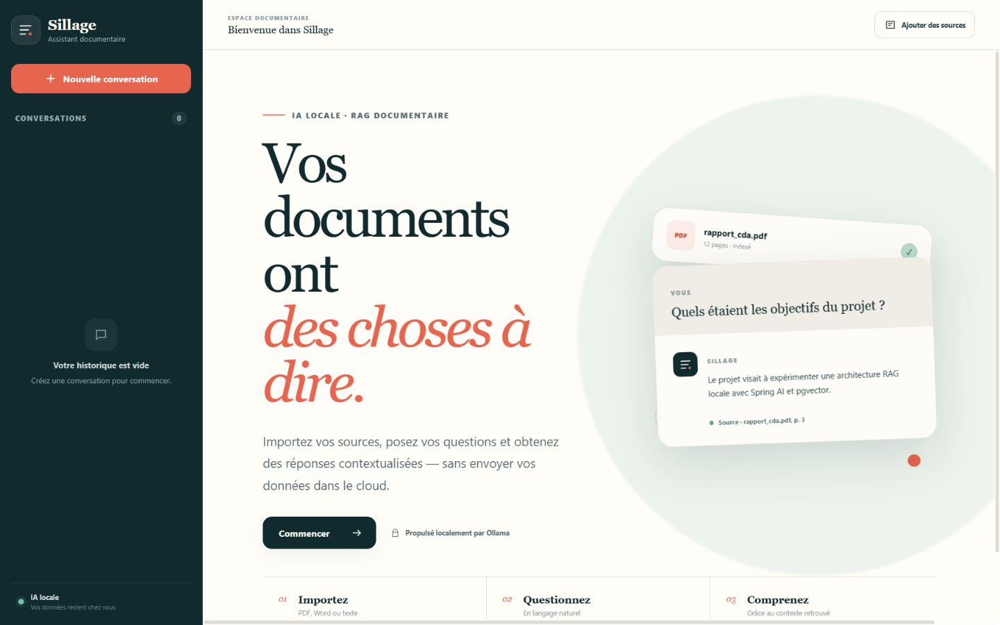
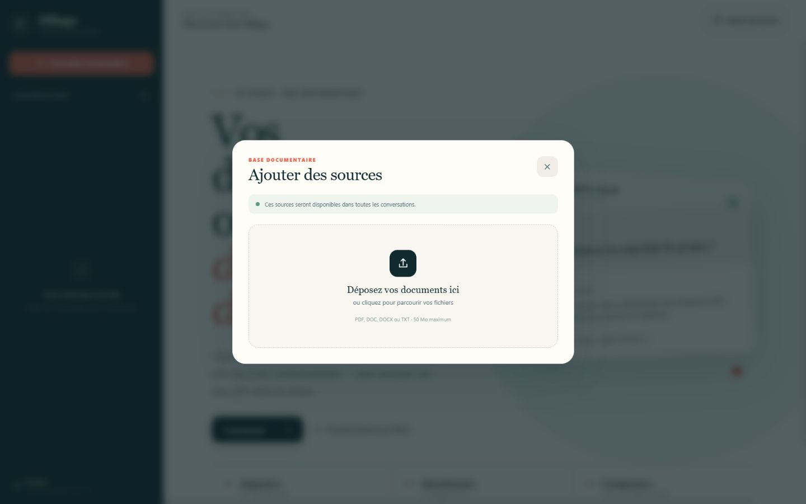
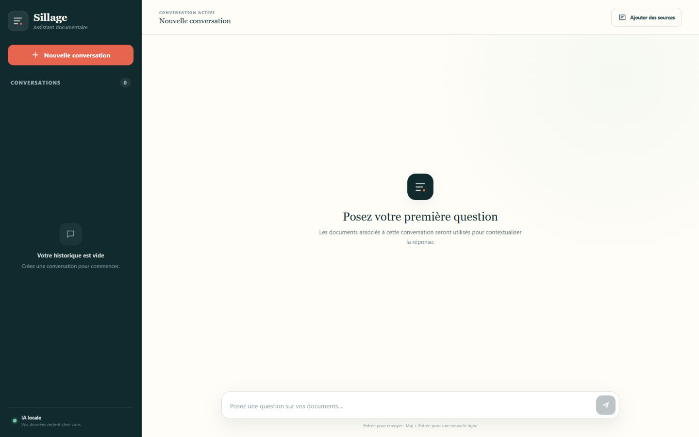
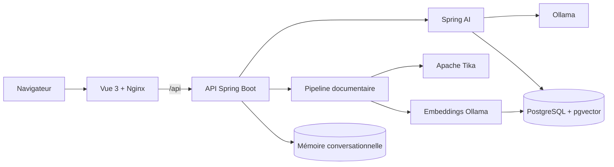

# Sillage

[](https://github.com/Maxwell49000/Sillage/actions/workflows/ci.yml)

> Interrogez vos documents. Gardez le contexte.

Sillage est un assistant documentaire local conçu avec Spring AI. Il extrait le contenu de fichiers PDF, Word ou texte, le découpe en fragments, produit des embeddings avec Ollama et recherche les passages les plus pertinents dans PostgreSQL/pgvector avant de générer une réponse.

Ce projet a été initié pendant une formation de Concepteur Développeur d’Applications, puis refondu pour démontrer une architecture RAG complète, locale et présentable en production.

## Aperçu

| Accueil desktop | Gestion des sources |
| --- | --- |
|  |  |

| Conversation | Version mobile |
| --- | --- |
|  |  |

La navigation mobile complète est également visible dans [`docs/screenshots/sillage-navigation-mobile.png`](docs/screenshots/sillage-navigation-mobile.png).

## Fonctionnalités

- conversations persistantes et historique des messages ;
- génération locale avec Ollama ;
- import de documents PDF, DOC, DOCX et TXT ;
- extraction de contenu avec Apache Tika et PDFBox ;
- découpage et vectorisation des documents ;
- recherche sémantique avec PostgreSQL et pgvector ;
- documents globaux ou limités à une conversation ;
- interface Vue responsive et accessible ;
- API REST documentée avec une collection Postman.

## Architecture



## Stack technique

| Couche | Technologies |
| --- | --- |
| Frontend | Vue 3, Vite, Pinia, Axios, CSS |
| Backend | Java 21, Spring Boot 3, Spring AI, Spring Data JPA |
| IA locale | Ollama, Gemma 3, nomic-embed-text |
| Données | PostgreSQL, pgvector |
| Documents | Apache Tika, PDFBox |
| Infrastructure | Docker Compose |

## Démarrage avec Docker

Le mode recommandé utilise Docker pour PostgreSQL, l’API et le frontend, tout en conservant Ollama sur la machine hôte pour profiter facilement de l’accélération disponible.

Prérequis : Docker Desktop et [Ollama](https://ollama.com/).

1. Télécharger les modèles et vérifier qu’Ollama est démarré :

   ```powershell
   ollama pull gemma3:1b
   ollama pull nomic-embed-text
   ```

2. Préparer éventuellement les variables Docker :

   ```powershell
   Copy-Item .env.example .env
   ```

3. Construire et démarrer Sillage :

   ```powershell
   docker compose up --build -d
   ```

L’interface est disponible sur `http://localhost:8000` et l’API sur `http://localhost:8080`. Les services deviennent disponibles uniquement après leurs healthchecks respectifs.

```powershell
docker compose ps
docker compose logs -f backend
docker compose down
```

Les données PostgreSQL persistent dans le volume `sillage_postgres-data`. `docker compose down` ne le supprime pas.

### Mode entièrement conteneurisé

L’override Ollama démarre le serveur IA dans Docker et télécharge automatiquement les deux modèles. Aucun GPU spécifique n’est imposé afin de rester portable.

```powershell
docker compose -f docker-compose.yml -f docker-compose.ollama.yml up --build -d
```

Le premier démarrage peut être long, car environ 1,1 Go de modèles doivent être téléchargés dans le volume `sillage_ollama-data`.

## Développement local

Prérequis supplémentaires : Java 21 avec `JAVA_HOME`, Node.js 22 et npm 9 ou supérieur.

1. Démarrer uniquement PostgreSQL :

   ```powershell
   docker compose up -d postgres
   ```

2. Démarrer le backend depuis la racine :

   ```powershell
   .\mvnw.cmd spring-boot:run
   ```

3. Démarrer le frontend dans un second terminal :

   ```powershell
   Set-Location front
   npm ci
   npm run dev
   ```

L’interface est disponible sur `http://localhost:8000`. Le serveur Vite relaie les requêtes `/api` vers le backend sur `http://localhost:8080`.

## Configuration

Les principales variables sont documentées dans [.env.example](.env.example). Docker Compose charge automatiquement le fichier `.env`; un lancement direct avec Maven utilise les variables du terminal et les valeurs par défaut Spring.

| Variable | Valeur par défaut | Usage |
| --- | --- | --- |
| `DATABASE_URL` | `jdbc:postgresql://localhost:5433/chatspringai` | Connexion JDBC |
| `DATABASE_USER` | `postgres` | Utilisateur PostgreSQL |
| `DATABASE_PASSWORD` | `postgres` | Mot de passe PostgreSQL |
| `OLLAMA_BASE_URL` | `http://localhost:11434` | Serveur Ollama |
| `OLLAMA_CHAT_MODEL` | `gemma3:1b` | Modèle de conversation |
| `OLLAMA_EMBEDDING_MODEL` | `nomic-embed-text` | Modèle d’embeddings |
| `FRONTEND_PORT` | `8000` | Port de l’interface Docker |
| `BACKEND_PORT` | `8080` | Port de l’API Docker |
| `DATABASE_PORT` | `5433` | Port PostgreSQL lié à l’interface locale |
| `CORS_ALLOWED_ORIGINS` | ports locaux 8000 et 3000 | Origines autorisées hors reverse proxy |
| `VITE_API_URL` | vide | URL d’une API distante |

Les paramètres de recherche RAG et les limites d’upload se trouvent dans `src/main/resources/application.properties`.

## Vérification

Backend :

```powershell
.\mvnw.cmd test
```

Frontend :

```powershell
Set-Location front
npm run lint
npm run build
```

Les tests backend isolent les contrôleurs de PostgreSQL et d’Ollama. Les tests d’intégration complets nécessitent les services Docker et les modèles locaux.

## Intégration continue

Le workflow GitHub Actions [`.github/workflows/ci.yml`](.github/workflows/ci.yml) exécute en parallèle :

- les tests Maven avec Java 21 ;
- le lint et le build Vue avec Node.js 22 ;
- la validation des fichiers Compose ;
- le build des images API et web.

Sur la branche `main`, les images validées sont publiées dans GitHub Container Registry sous `ghcr.io/maxwell49000/sillage-api` et `ghcr.io/maxwell49000/sillage-web`. Dependabot surveille Maven, npm, Docker et GitHub Actions.

## API principale

| Méthode | Route | Description |
| --- | --- | --- |
| `POST` | `/api/chat/conversations/new` | Crée une conversation |
| `GET` | `/api/chat/conversations` | Liste les conversations |
| `GET` | `/api/chat/history/{id}` | Charge l’historique |
| `POST` | `/api/chat/send` | Envoie un message |
| `DELETE` | `/api/chat/conversations/{id}` | Supprime une conversation |
| `POST` | `/api/documents/upload` | Indexe un document |
| `DELETE` | `/api/documents/{id}` | Supprime un document et ses vecteurs |

La collection `postman_collection.json` permet de tester les parcours complets.

## Structure du dépôt

```text
front/                  application Vue et image Nginx
.github/workflows/      pipeline d’intégration continue
src/main/java/          API et services Spring Boot
src/main/resources/     configuration et schéma SQL
src/test/               tests automatisés
Dockerfile              image multi-stage du backend
docker-compose.yml      stack principale
docker-compose.ollama.yml override IA entièrement conteneurisé
postman_collection.json collection de requêtes API
```

## Vie privée et limites

Sillage est pensé pour une exécution locale : les documents et les prompts sont transmis à l’instance Ollama configurée. Si `OLLAMA_BASE_URL` ou `VITE_API_URL` cible un service distant, les garanties de confidentialité dépendent de ce service.

La qualité des réponses dépend du modèle, de la qualité des documents et des paramètres de recherche. Une réponse générée doit toujours être vérifiée avant un usage sensible.
